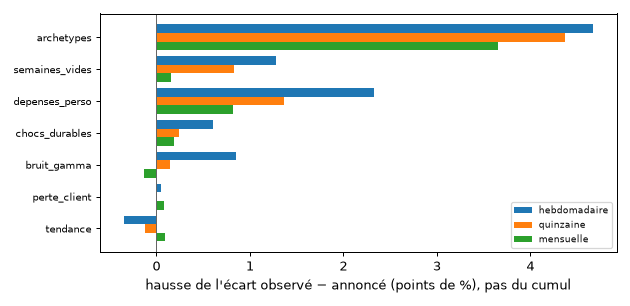
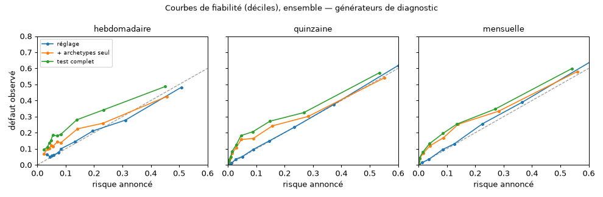
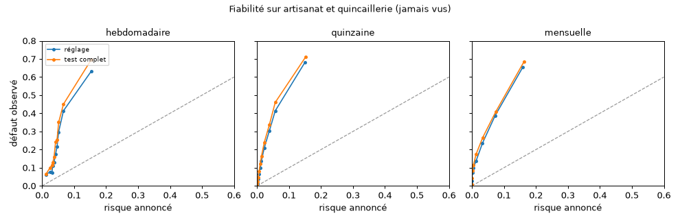

# Diagnostic du risque : d'où viennent (A) et (B) ?

> **Conclusion.** La cause principale est **l'arrivée des deux activités jamais vues (artisanat, quincaillerie)**. Le modèle v3 les reconnaît à leur « empreinte » (ticket moyen élevé, peu d'opérations par semaine) et leur attribue la sécurité des activités vues qui leur ressemblent (tissus, téléphonie). Il leur annonce ainsi un risque **2 à 6 fois plus bas** que celui du simulateur du moteur : quincaillerie annoncée **4,8 %**, défaut observé **30,8 %** ; artisanat **2,6 %** contre **13,0 %**.
> Cet écart à lui seul explique **50 % (hebdo), 64 % (quinzaine) et 75 % (mensuel)** de la sous-estimation (A). Il explique aussi **100 % de (B)** : sur les activités vues, le moteur bat la règle naïve sous le générateur de test complet ; sur les activités jamais vues, il fait moins bien qu'elle, déjà avec les paramètres de réglage.
> Le reste de (A) vient de deux écarts **invisibles dans les flux passés** : les dépenses personnelles imprévues (4 → 6 %/sem., 17–25 %) et les semaines vides (2 → 3,5 %, 3–14 %).

Données **simulées**. Il s'agit d'un diagnostic, pas d'un run final. Les graines sont neuves (`graines.json`) ; aucun jeu ni aucune graine des runs finaux n'a été utilisé. Le modèle v3 de production (`ml/artifacts/modeles-v3.json`) est resté inchangé, et le dossier `docs/evaluation/runs` aussi.

## 1. Inventaire des écarts réglage → test (`packages/generator/kwedo_gen/core.py`, `archetypes.py`)

| Écart | Paramètre | Réglage | Test | Observable dans les flux du commerçant ? |
|---|---|---|---|---|
| Bruit journalier | `bruit` | log-normal | gamma (même moyenne, même variance relative) | Oui (forme des ventes), faiblement |
| Baisses durables | `p_choc_durable` | 0,15 | 0,22 | En partie : la baisse passée se voit ; la baisse future est tirée indépendamment |
| Semaines vides | `p_semaine_vide` | 0,02 | 0,035 | En partie : on voit les semaines vides passées (`part_semaines_vides`), mais 52 semaines donnent peu de signal sur une probabilité de 2–3,5 % |
| Perte d'un gros client | `p_perte_client` | 0,08 | 0,12 | Non (futur seulement) |
| Dépenses personnelles imprévues | `p_depense_perso` | 0,04 | 0,06 | **Non** (futur caché seulement, après la marge) |
| Dérive de tendance | `derive_tendance` | 0,15 | 0,22 | Oui (`tendance_hebdo`, `recent4_sur_median`) |
| Archétypes jamais vus | `archetypes` | 5 activités | 7 (+ artisanat, quincaillerie) | Le **profil** se voit (ticket, fréquence, irrégularité, crédit), la **marge** non |
| Marge par activité | `Archetype.marge` | 0,15–0,30 | idem + artisanat 0,40, quincaillerie 0,22 | **Non** (invisible du moteur, ADR 0008) |
| Saisonnalité | `saison_mois` | par activité | idem ; quincaillerie creuse en été | Oui |
| Ventes à crédit | `credit_ventes` | 0,05–0,12 | idem ; artisanat 0,20, quincaillerie 0,18 | En partie (encaissements différés) |
| Manipulation | `p_manipulation` | 0,15 | 0,15 | Aucun écart |

Les quatre dernières lignes ne sont pas des réglages distincts : elles arrivent avec les archétypes nouveaux. Le script vérifie que réglage + les 7 écarts = `TEST` (assertion).

## 2. Ablation

Méthode (`ml/diagnostic_ablation.py`) :
- On part de `REGLAGE`. On active un seul écart à la fois, puis on les cumule dans l'ordre d'impact sur (A) hebdomadaire, jusqu'au générateur de test complet.
- Chaque variante compte 2 000 commerçants, plus 1 000 commerçants d'activités jamais vues générés avec les mêmes paramètres que la variante. Ce second échantillon permet de mesurer (B) dans toutes les variantes.
- Les graines sont les mêmes dans toutes les variantes (nombres aléatoires communs). On évalue les 12 cellules fréquence × durée, avec 6 montants par commerçant (0,5 à 2 × plafond) comme dans le protocole.
- La règle naïve est la médiane de la période × k, à montant total accordé égal. Les IC sont des bootstraps à 95 % par commerçant (1 000 tirages).

Contrôle : le cumul complet reproduit le constat publié. En hebdomadaire, on annonce 11,8 % pour 21,6 % observé (ECE 0,099) ; le run publié donnait 11,8 % pour 20,6 % (ECE 0,089).

### (A) Écart observé − annoncé (points de %), ensemble des commerçants

| Variante | Hebdo | IC 95 % | ECE | Quinzaine | ECE | Mensuel | ECE |
|---|---|---|---|---|---|---|---|
| Réglage | +0,4 | [−0,8 ; +1,6] | 0,015 | +0,4 | 0,005 | +1,1 | 0,011 |
| + archétypes seul | **+5,1** | [3,9 ; 6,4] | **0,058** | **+4,8** | 0,051 | **+4,7** | 0,048 |
| + semaines vides seul | +2,8 | | 0,031 | +1,4 | | +1,5 | |
| + dépenses perso seul | +2,4 | | 0,025 | +1,7 | | +1,9 | |
| + chocs durables seul | +0,9 | | 0,017 | +0,4 | | +1,3 | |
| + bruit gamma seul | +0,8 | | 0,017 | +0,2 | | +0,6 | |
| + perte client seul | +0,5 | | 0,015 | +0,5 | | +1,2 | |
| + tendance seul | −0,1 | | 0,018 | −0,5 | | 0,0 | |
| Test complet (cumul) | +9,8 | [8,5 ; 11,3] | 0,099 | +7,2 | 0,073 | +5,9 | 0,059 |

### Part de la dégradation expliquée (pas du cumul, dans l'ordre d'impact)

| Écart (ordre du cumul) | Part de (A) hebdo | quinzaine | mensuel | Part de (B) |
|---|---|---|---|---|
| 1. archétypes jamais vus | **50 %** | **64 %** | **75 %** | **100 %** (voir ci-dessous) |
| 2. semaines vides | 14 % | 12 % | 3 % | ≈ 0 |
| 3. dépenses personnelles | 25 % | 20 % | 17 % | ≈ 0 |
| 4. chocs durables | 7 % | 4 % | 4 % | ≈ 0 |
| 5. bruit gamma | 9 % | 2 % | −3 % | ≈ 0 |
| 6. perte d'un client | 0,5 % | 0 % | 2 % | ≈ 0 |
| 7. tendance | −4 % | −2 % | 2 % | ≈ 0 |



### (B) Moteur − règle naïve (médiane × k), part d'échéances manquées, 4 durées réunies (points de %)

| Variante | Périmètre | Hebdo [IC] | Quinzaine [IC] | Mensuel [IC] |
|---|---|---|---|---|
| Réglage | activités vues | **−0,36** [−0,53 ; −0,21] | −0,50 [−0,66 ; −0,35] | −0,63 [−0,85 ; −0,43] |
| Réglage | activités jamais vues | **+0,14** [+0,07 ; +0,22] | +0,09 [0,00 ; +0,19] | −0,08 [−0,21 ; +0,05] |
| Test complet | activités vues | −0,50 [−0,72 ; −0,30] | −0,67 [−0,90 ; −0,45] | −0,60 [−0,88 ; −0,33] |
| Test complet | activités jamais vues | +0,11 [+0,02 ; +0,21] | +0,03 [−0,07 ; +0,13] | 0,00 [−0,10 ; +0,12] |

(B) est donc **entièrement** un effet d'activité. Avec les paramètres de réglage (même bruit, mêmes chocs), le moteur perd déjà contre la règle sur l'artisanat et la quincaillerie, et un peu plus en hebdomadaire, comme dans le run publié. Ajouter les autres écarts ne change (B) que de ±0,05 point, dans le bruit des IC. Sur les activités vues, le moteur reste meilleur que la règle dans toutes les variantes.

## 3. Pourquoi le modèle ne le voit pas

**Les entrées changent, mais le modèle les lit dans le mauvais sens.** Entre le réglage et « + archétypes », les distributions d'entrée se décalent nettement (Kolmogorov-Smirnov, p < 10⁻¹⁰) : `log_ticket` KS 0,29, `log_tx_semaine` 0,26, `log_payeurs` 0,23, `jours_actifs` 0,22, `p10_sur_median` 0,20. Ce n'est donc pas une cause non observable. Le problème vient de l'**extrapolation** :

- À partir du seul profil, l'activité se reconnaît à **99,3 %** (validation croisée sur 3 plis ; 16,7 % au hasard). Aucune variable d'activité n'entre dans le modèle, donc il n'y a pas de fuite directe. Mais le profil sert de **substitut à la marge cachée** de chaque activité vue.
- Après les trois variables du montant, les variables les plus importantes (gain, hebdo) sont `log_tx_semaine` (5,8 %), `log_median` (4,2 %) et `log_ticket` (3,9 %). Sur les activités vues, un ticket élevé et peu d'opérations, c'est tissus (marge 0,30) ou téléphonie : le modèle a appris « ticket élevé → sûr ».
- L'artisanat (ticket ~12 900) et la quincaillerie (~16 000) sont **hors de l'étendue d'entraînement** (maximum vu : tissus, ~9 400). Pour eux, le modèle annonce 2,6 % et 4,8 %, alors que le **risque simulé** du moteur reste à ~9 % comme ailleurs. La marge réelle n'est pourtant pas plus haute : quincaillerie 0,22, sous la moyenne des activités vues. L'artisanat a une marge de 0,40, mais une dispersion de 0,75 et 20 % de ventes à crédit.

Résidus (observé − annoncé) par activité, générateur de test complet :

| Activité | Annoncé | Observé | Résidu | AUC v3 |
|---|---|---|---|---|
| quincaillerie (jamais vue) | 4,8 % | 30,8 % | **+26,0** | 0,81 |
| artisanat (jamais vue) | 2,6 % | 13,0 % | **+10,4** | 0,78 |
| alimentation | 19,9 % | 26,8 % | +6,8 | 0,81 |
| téléphonie | 16,7 % | 21,5 % | +4,8 | 0,81 |
| tissus | 10,1 % | 12,1 % | +2,0 | 0,78 |
| cosmétique | 11,3 % | 12,8 % | +1,5 | 0,83 |
| restauration | 14,6 % | 15,3 % | +0,6 | 0,82 |

Le **classement** reste bon (AUC 0,81 sur les activités jamais vues, contre 0,77 pour une régression logistique à 2 variables apprise sur le réglage) : c'est le **niveau** qui est faux. Le moteur accorde le plafond où le risque annoncé reste ≤ 10 % ; il accorde donc trop aux activités inconnues, et c'est ce qui le fait passer derrière la règle naïve, qui ne lit pas le ticket.

**Écarts non observables.** Les dépenses personnelles (+2,4 points seules) et la perte de client ne touchent que le futur caché. Avec les entrées du réglage (même graine, mêmes flux passés), seul le défaut change. C'est une cause **non observable** par construction ; le diagnostic d'ADR 0008 la relevait déjà sur le réglage. Les semaines vides sont un cas mixte : le passé en montre, mais trop peu pour estimer 3,5 % contre 2 %.

**Forme de la sous-estimation** (recalibration logistique : observé ~ σ(a + b·logit(annoncé)), hebdo). Réglage : a = −0,16, b = 0,87. « + archétypes » : b = **0,61**. Test complet : a = +0,08, b = 0,61. C'est une **pente**, pas un simple décalage : à risque annoncé faible (2–10 %), on observe 2 à 3 fois plus, alors qu'au-delà de 20 % l'annonce est presque juste. Cela explique pourquoi les « petits risques » sont les plus touchés. Les écarts non observables ajoutent ensuite un décalage (a passe de −0,16 à +0,08).




## 4. Pistes chiffrées (non appliquées)

Les gains ci-dessous sont mesurés sur les variantes de diagnostic : réglage sur une moitié des commerçants, mesure sur l'autre.

| Cause | Correctif possible | Gain mesuré | Coût | Risque de « régler sur le test » |
|---|---|---|---|---|
| Activité inconnue extrapolée | **Plancher** : pour une activité absente de l'entraînement, risque annoncé ≥ risque simulé du moteur | ECE jamais vus 0,182 → **0,120** (test complet), 0,156 → 0,098 (réglage) ; annoncé 3,7 % → 9,8 % pour 21,9 % observé | Faible : l'activité est déjà déclarée au dépôt | Nul : aucun paramètre appris sur le test |
| idem | Monotonie / bornage des variables `log_ticket`, `log_tx_semaine` (pas d'extrapolation hors étendue) ou réentraînement sans elles | Non mesuré ici (demande un réentraînement) | Moyen | Faible si choisi sur le réglage |
| idem | Marge de prudence par activité inconnue (plafond réduit) | Le plancher ci-dessus en est la version minimale ; reste un écart de +12 points dû à la marge invisible | Faible | Moyen si la marge est tirée du test |
| Pente de calibration | Recalibration a + b·logit avec incertitude | ECE test complet 0,079 → **0,012** (a 0,13, b 0,64) ; décalage seul : 0,054 | Faible | **Élevé** : appliquer au réglage le décalage appris sur le test fait passer son ECE de 0,007 à **0,084**. À ne faire qu'avec des données réelles |
| Dépenses personnelles, perte de client, semaines vides (non observables) | Données réelles de remboursement ; question déclarative (charges familiales) ; marge d'incertitude sur l'avenir | Non mesurable en simulation : toute valeur choisie revient à choisir le générateur | Élevé (données) | Élevé |

Conseil de priorité : traiter d'abord l'activité inconnue avec le plancher, puis la restriction de l'extrapolation, car c'est la seule cause qu'on peut corriger sans se régler sur le test. Pour la pente et les causes non observables, il faut des remboursements réels.

## Limites
- Tout est simulé, et le diagnostic dépend des choix du générateur : la marge invisible par activité en est un.
- Les parts du cumul dépendent de l'ordre (interactions). L'effet de chaque écart seul est donné à côté.
- Avec 2 000 + 1 000 commerçants par variante, les petits écarts (bruit gamma, perte de client, tendance) sont dans le bruit des IC.
- Seule la règle « médiane × k » figure dans le tableau B ; la règle « moyenne × k » est dans `ablation.json`.

## Reproduire
```
nice -n 10 .venv/bin/python ml/diagnostic_ablation.py   # ~60 min, 4 cœurs → ablation.json
nice -n 10 .venv/bin/python ml/diagnostic_analyse.py    # → analyse.json, PNG ; supprime data/generated/diagnostic
```
